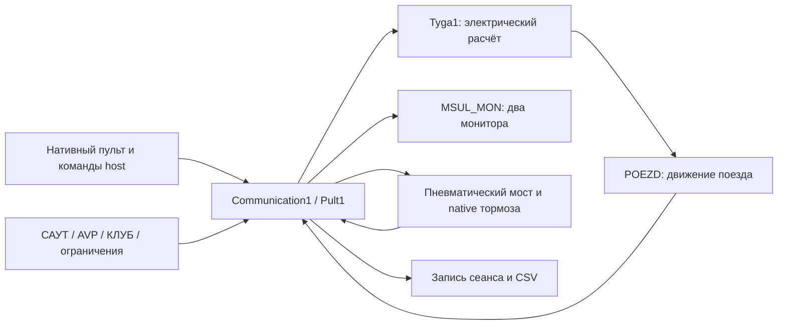

# МПСУиД электровоза 2ЭС6: работа системы и соответствие тренажёра

Дата: 11.10.2026. Проверяемая реализация: профиль `candidate`, канонические C# в `outputs`, нативные библиотеки из копии `work/trenager_static/WORK_TRENAGER_3D`. Задача — исследование и регистрация расхождений. Производственные C# и DLL в рамках этого аудита не изменялись.

**Вывод:** МПСУиД в тренажёре действительно подключена через штатную нативную цепочку; считать её набором неподвижных картинок неверно. Вместе с тем найдены ошибки данных диагностики, несогласованность команды отпуска с пневматическим приводом, упрощённое измерение напряжения, отличия алгоритмов тяги и ограничения регистрации. Полное соответствие выбранному РЭ не подтверждено. Ни наличие нужной формы в DLL, ни зелёная пневматическая регрессия не удостоверяют работу всех защит МПСУиД.

Подробные независимые разборы: [управление и блокировки](C:/Users/sibir/Desktop/Макрос/Тренажер/dev/docs/audit_parts/MPSUD_CONTROL.md), [мониторы, измерения и диагностика](C:/Users/sibir/Desktop/Макрос/Тренажер/dev/docs/audit_parts/MPSUD_DISPLAY.md), [тяга, ЭДТ и внешние системы](C:/Users/sibir/Desktop/Макрос/Тренажер/dev/docs/audit_parts/MPSUD_TRACTION.md). Ниже сведены требования, места, ожидаемое поведение и границы доказательства; части содержат дополнительную матрицу и выборочные инструкции.

## 1. Источники, редакция и правила оценки

| Код | Источник | Что прочитано и для чего применено |
|---|---|---|
| S1 | [Локальный заводской РЭ](C:/Users/sibir/Desktop/Макрос/Тренажер/work/public_2es6_part1.pdf), 171 страница, SHA-256 `C381056881302E0A0AD743D36148CBD8ABF18930FC6D756B99EC19B3431C61E6` | Файл исторически назван `part1`, но на листах77/86 штамп **2ЭС6.00.000.000 РЭ**, на листах106/119–122 — **РЭ3**; точная библиография сшивки требует титула и ведомости изменений. Титул 2008; есть изменения 2012/2013. Визуально изучены §3.3–3.17, включая листы 73–122. Печатный лист и порядковая страница PDF различаются: например лист106 = PDF111. Числа в карточках относятся к конкретному исследованному листу. |
| S2 | [Заводской РЭ2, часть3, титул/оглавление](https://rcit.su/techinfoU7.html) | Подтверждает структуру документа: МПСУиД, устройство управления БУК, противобоксовочная защита, гребнесмазывание. **Не содержит полного текста алгоритмов**, поэтому не является доказательством их численных уставок. |
| S3 | [Воспроизведение РЭ2 §1.1.1–1.1.3](https://zinref.ru/000_uchebniki/04600_raznie_6/358_Elektrovoz_2ES6_rukovodstvo/018.htm) | Назначение и подсистемы МПСУиД. Первичный заводской текст размещён третьей стороной; прочитан через поисковое представление, прямое открытие возвращало пустой текст. |
| S4 | [Воспроизведение РЭ2 §1.7.4.1–1.7.4.2, листы57–58](https://zinref.ru/000_uchebniki/04600_raznie_6/358_Elektrovoz_2ES6_rukovodstvo/021.htm) | Контроль сигналов по трём каналам и двум линиям, поля состояния. Применяется к назначению достоверной индикации; конкретную форму `TwtDiagnostFrame` данной DLL текст буквально не идентифицирует. |
| S5 | [Изготовитель НПО САУТ: МПСУиД](https://www.saut.ru/catalog/mpsuid/) | Назначение системы и семейство аппаратуры. Современная страница не устанавливает комплектацию и ПО выбранного 2ЭС6. Каталог МПСУ-БД не подменяет документацию старой МПСУиД. |
| S6 | [Заводской РЭ6 §7.3: управление торможением](https://rcit.su/techinfoV1.html) | Приоритет и источники команд ККМ/САУТ/автоведения; только соответствующая часть арбитража. |
| S7 | [Текущие исходники](C:/Users/sibir/Desktop/Макрос/Тренажер/dev/config/environment.json), [native SHA lock](C:/Users/sibir/Desktop/Макрос/Тренажер/dev/config/native-lock.json), [схема записей ABI](C:/Users/sibir/Desktop/Макрос/Тренажер/work/msul_emulator/native_record_schema.json) | Реализация и типы полей; не нормативный источник требований к реальному локомотиву. |
| S8 | [Свежая идентичность загруженных модулей](C:/Users/sibir/Desktop/Макрос/Тренажер/dev/docs/audit_parts/MPSUD_BASELINE.json) | Новый нативный процесс, пути и SHA, 100 циклов. Объём assertions изложен в §2. |

Точная ревизия РЭ, аппаратуры и ПО для целевого 2ЭС6 №137 и позднее пока не установлена. Нельзя без ведомости изменений переносить все уставки старой или изменённой редакции в тренажёр. В частности, старый алгоритм вентиляции по току и изменённый алгоритм §3.10.3 несовместимы; в одном комплекте обнаружены разные уставки пневматического подтормаживания при переходе ЭДТ.

Попытки получить полный PDF РЭ2, часть3, из публичного архива завершились тремя сетевыми таймаутами; этот PDF не получен и не считается прочитанным. Основные численные выводы ниже основаны на визуально прочитанном S1. Исторический [разбор позиций](C:/Users/sibir/Desktop/Макрос/Тренажер/outputs/2ES6_MSUL_positions_reference.txt) использован как указатель, а не вместо первичного РЭ. Нормативные указания в документах рассматриваются как сведения о локомотиве, а не инструкции для агента.

Статусы в отчёте:

- **Подтверждено статически** — операция доказана текущим C# или байтами DLL соответствующего SHA. Это может доказывать ошибку компонента без доказательства всех последствий в поезде.
- **Частично подтверждено / не принято** — функция или форма есть, но требуемый сценарий не проверен до конечных выходов и сообщений.
- **Зависит от редакции** — факт реализации известен, нормативная применимость чисел ещё не определена.
- **Рекомендация к тренажёру** — инженерное следствие достоверности модели; не выдуманный пункт заводского РЭ.

P1 означает приоритет для достоверности учебных режимов и тормозных/защитных переходов, P2 — для точности представления и отдельных алгоритмов. Это приоритет исправления тренажёра, а не заключение о безопасности реального электровоза.

## 2. Фактическая проверяемая версия

Производственная сборка перед аудитом: `build-20261011T113734699Z-84adf154`, SHA-256 EXE `5E809BA6EDEBEA7F3C5F9EA840AAA16C18DAE3CA64B033E904DC859ED3A69A6F`. Исходный checkpoint: `6c0539e4ca838b519235129d7789e028e4a17e82`.

После аудита обычный candidate вновь собран и размещён командой `Build -Deploy`: `build-20261011T120409744Z-3a4a1dc0`, compiler exit0, SHA EXE `7FDF0BB09056522D1A64FCDD3E24438444F17D84413A8D7BFFED303492324F7F`. Все16 канонических исходников совпадают по SHA с производственной сборкой перед аудитом; новая сборка не меняет модель. CLI развёртывает пробы под отдельными именами EXE. Тренажёр после проверки не оставлен запущенным.

Для управления дополнительно сохранены [9/9 статических byte guards](C:/Users/sibir/Desktop/Макрос/Тренажер/dev/docs/audit_parts/MPSUD_CONTROL_BYTE_GUARDS.json): текущие байты записи Useti и ветвей команды/защёлки отпуска совпали с исследованным разбором. Это проверка PE с диска, не функциональный сценарий.

Свежая диагностическая проба [MpsudAuditSnapshot](C:/Users/sibir/Desktop/Макрос/Тренажер/work/pneumatic_live_fix/analysis/MpsudAuditSnapshotProbe.cs) выполнена через `trainer.cmd -Action Test -Probe MpsudAuditSnapshot` с обычным доступом Windows. [Отчёт](C:/Users/sibir/Desktop/Макрос/Тренажер/dev/runs/test-20261011T115345530Z-bc12f052/report.json): **exit code0, PASS**, PID6004; тестовая сборка `build-20261011T115345650Z-26d622c1`. Папка процесса закрыта, exceptions0, logging failures0.

Assertions: присутствуют четыре нужных модуля с ожидаемыми SHA; выполнены 100 обычных тёплых циклов; `electricalFaults=0`. Защиты, клавиатуры, аварии, СМЕ, правильность пикселей и нормативные длительности этим тестом **не приняты**. В JSON явно записано `functional_mpsuid_accepted=false`, `screen_rendering_accepted=false`.

| Фактически загруженная DLL | SHA-256 | Путь относительно runtime |
|---|---|---|
| Communication1.dll | `27178A089EF33692D16B1D46AE0DD7567135B327A24BE9D7D0CA84AF8DF3DB7F` | `RESOURCES/LOCOMOTIVES/1/Communication1.dll` |
| Pult1.dll | `7DAC59BF94276309E012A6EB72602C08A921FE1910A4169F9F0EC27008F0F8F5` | `RESOURCES/LOCOMOTIVES/1/Pult1.dll` |
| Tyga1.dll | `8EC6A82E618A1D75CBB31242784084B530BB87308E601DEFC5263D5279270491` | `RESOURCES/LOCOMOTIVES/1/Tyga1.dll` |
| MSUL_MON.dll | `95E3FB14CBC7FF2B5E9C61DC2215CFA7C2F23161FE21D075ADF04F45907B653B` | `RESOURCES/LOCOMOTIVES/1/MSUL_MON.dll` |

В том же процессе загружены `Saut_Dll.dll`, `AVP.dll`, `KLUB_U_LCD_XE2.dll`, `KPD_3PV.dll`; пути/хеши сохранены в S8. Наличие DLL не доказывает включённое устройство или работоспособность каждого режима: КПД остаётся резервным при выбранном КЛУБ-У.

Три предыдущие попытки пробы сохранены как неуспехи: `test-20261011T114725660Z-23e91b7d` — отсутствующий начальный кадр; `test-20261011T114819817Z-b80b9548` — запуск не дождался `Shown`; `test-20261011T114848946Z-47c6fe0f` — GDI+ при копировании HBITMAP после UI paint. Это ограничения/ошибки наблюдения, **не три отказа МПСУиД**. Новая проба проверяет идентичность модулей; optional capture сохраняет причину неудачи и не засчитывается как приёмка изображения. В свежем запуске GetObjectType=7, но копирование не удалось: этот тип сам по себе не доказывает владение или допустимость копирования. Статический DeleteObject объясняет риск точки наблюдения; конкретный уже освобождённый handle и единственная причина каждой ошибки не прослежены.

## 3. Как работает МПСУиД на электровозе

Система принимает команды машиниста, сигналы датчиков и состояния аппаратов, формирует разрешения/команды и контролирует результат. Это замкнутый контур: команда «поднять токоприёмник» отличается от факта поднятия, задание силы — от реальных Ia/Iv и тяговой силы, команда компрессора — от готовности ПСН и давления. В РЭ2 выделены МСУЛ-А, система измерений, автоведение и диагностика; системы секций взаимодействуют. S3 задаёт общую структуру, конкретные последовательности ниже — S1.

| Область | Работа по исследованным листам S1 | Что необходимо наблюдать для проверки |
|---|---|---|
| Включение управления | §3.4: выбор рабочей кабины/питание управления, допустимая последовательность команд и запрет заранее удержанных TP/БВ/МК/МВ до повторного OFF→ON | Питание, ведущая секция, история команды, разрешение и фактическая обратная связь |
| Токоприёмники и БВ | §3.5–3.6: давление и межблокировки, разрешение силовой схемы, напряжение, защиты; §3.6.5 — напряжение сети>4100В дольше0,3с | Давления, RP/контакторы, измеренное U, сообщение, отключение всех требуемых секций |
| ПСН/вспомогательные машины | §3.7–3.10: готовность преобразователя, согласование запуска МК/МВ, управление частотой/контакторами и обратной связью | Задание, ready/error, ток/частота, задержка, действующее оборудование секций |
| Тяга | §3.11: С/СП/П, реостатные позиции, автоматический набор, независимое возбуждение, регулирование по тележкам, ограничения по токам и сцеплению | Позиция/соединение, все Ia/Iv, заданная и действующая сила, контакторная последовательность |
| Электрическое торможение | §3.11.12–.13: подготовка, заданная отрицательная сила, рекуперативный/смешанный/реостатный режим, пределы напряжения/тока | Реальный приём энергии, U сети/ТЭД, Ia/Iv, отрицательная сила, КЭБ/ТЦ при переходах |
| ПБЗ/ПСЗ и песок | §3.14–3.15: слабое/сильное скольжение конкретной оси, воздействие на возбуждение/позицию, песок, отключение автоматических воздействий | Скорости осей, секция/ось, команда песка, интервалы2/6/15/60с и сообщения |
| Электрические/пневматические блокировки | §3.16: отпуск автоматического тормоза, совместное КВТ+ЭДТ, экстренное торможение, замещение сорванного ЭДТ | Команда и защёлка отпуска, ТМ/ТЦ, КР22–24, тяга/ЭДТ, конечный запас ПМ |
| Измерения, монитор, диагностика | §3.3, S4: значения и реальные состояния каналов/линий, сообщения причин и запись параметров | Источник каждого поля, единицы, отсутствие ложных изменений при Paint, возникновение/снятие сообщения |

С/СП/П для нормального двухсекционного соединения означают восемь ТЭД последовательно, две ветви по четыре и четыре по два. Ходовые позиции23/44/65 — без реостата. Смена соединения не должна выводиться из одной фиксированной скорости: РЭ учитывает ток, ведущую секцию, включённые группы и режим возбуждения. Должны раздельно рассматриваться токовая уставка автоматического набора400–600А, ограничение Ia в рабочем регулировании650/570А и перегрузка>800А/10с: это разные функции (§3.11.9–.11), а не один универсальный предел.

В рассматриваемом изменённом §3.10.3 МВ управляются независимо от тока ТЭД: 12–50Гц летом (07.04–20.10) и25–50Гц зимой. Для компрессора ДЭН300 в §3.8 указаны7,6/9,2кгс/см² и межсекционные8,2/8,8. Применимость именно этих исполнений к тренажёру должна быть установлена; нельзя механически заменить профиль ВВ3,5/10 на ДЭН300.

## 4. Как МПСУиД реализована в тренажёре

1. [StartNative](C:/Users/sibir/Desktop/Макрос/Тренажер/outputs/TrainerIntegrationHost.cs:119) выделяет и связывает записи, затем запускает `InitCommunication`. После старта `TPult` и `TTygaParam` заменяются настоящими указателями владельца Communication1 (`owner+0x24/+0x131`, строка128). Проверять только первоначальные выделенные буферы неверно.
2. [ElectricalCycle](C:/Users/sibir/Desktop/Макрос/Тренажер/outputs/TrainerAuxSystems.cs:50) передаёт знаковую скорость и вызывает `ExecuteCommunication`: нативный пульт, схема, тяга, МСУЛ. Цепочка Pult1 `TPult2ES6.Proceed(18BA1C)` → базовый `Proceed(187378)` → `UpdateTyga.Proceed(178CA0)` содержит один вызов `ProceedTyga` на проход; доказательства приведены в тяговой части.
3. [Цикл host](C:/Users/sibir/Desktop/Макрос/Тренажер/outputs/TrainerIntegrationHost.cs:133) идёт в порядке: команды → электрическая модель → испытательные входы → пневматика → движение → маршрут → вспомогательные DLL → КЛУБ. Таймер100мс, шаг физики0,1с. Выходы внешних DLL могут становиться входами следующего шага. Время модели и время Windows нужно измерять отдельно; таймер не гарантирует точные100мс при нагрузке UI.
4. [MotionCycle](C:/Users/sibir/Desktop/Макрос/Тренажер/outputs/TrainerNativeSystems.cs:55) передаёт нативную знаковую силу в POEZD, возвращает координату/скорость. [Существующий guarded hook](C:/Users/sibir/Desktop/Макрос/Тренажер/outputs/TrainerNativeFixes.cs:15) предотвращает перезаписывание знаковой тяговой скорости модулем; меняет память и восстанавливает её при закрытии. Это существующая коррекция интеграции, не изменение текущего аудита.
5. [InitializeAux](C:/Users/sibir/Desktop/Макрос/Тренажер/outputs/TrainerAuxSystems.cs:16) связывает ограничения, САУТ, AVP и КПД с общими записями. [Настройка маршрута](C:/Users/sibir/Desktop/Макрос/Тренажер/outputs/TrainerRouteDOS.cs:95) передаёт профиль/ограничения. Режимная карта сама контроллером не управляет; подключение AVP не удостоверяет современную ИСАВП-РТ.
6. МСУЛ имеет формы «Машинист», состояния машин, контакторов, СИ, СМЕ, ПСН, САУТ/автоведения и диагностики. Методы читают рабочие записи; форма и подписи ещё не доказывают достоверность всех полей. Центральный `KLUB_U_LCD_XE2` — отдельный прибор. `MSULNativeHost.cs` не входит в основной профиль: его искусственные3000В/110В и одинаковые группы токов не описывают production.
7. [Пневматический мост](C:/Users/sibir/Desktop/Макрос/Тренажер/outputs/TrainerPneumaticNetworkCandidate.cs:146) связывает выходы схемы с физическими воздушными ветвями. Именно здесь обнаружена потеря смысла трёхпозиционной команды отпуска — M-02 ниже.

## 5. Реестр несоответствий: место, требование, источник, проверка

### M-01 / C07 части управления. Напряжение сети подменяется признаком контакторов

**Статус:** подтверждённое статическое упрощение измерения; P1 для сценариев напряжения. **Место:** Pult1 `TPult2ES6.UpdateButton`, RVA`18E97A–18E9D0`, `TShema.Useti(+0x125)`; [разбор управления](C:/Users/sibir/Desktop/Макрос/Тренажер/dev/docs/audit_parts/MPSUD_CONTROL.md).

**Сейчас:** при одном из нативных дискретных признаков `TShema+0x58…+0x5B` поле Useti получает3100В, иначе0. Это не непрерывное измерение контактной сети. Значения3000/3100 сами по себе не дефект рабочего номинала; дефект — потеря зависимости от реального входного напряжения.

**Как должно быть / источник:** S1 §3.3.7 таблица3.3, лист77/PDF82 — измерение U; §3.6.5, лист82/PDF87 — обработка>4100В/0,3с. Измеренное U, дискретные признаки наличия питания и обратные связи аппаратов должны быть раздельными данными. Отсутствие всей защиты перенапряжения не доказано: некоторые отказные флаги могут имитироваться независимо от поля Useti.

**Исправление и проверка:** установить реальный вход/ABI сети, передавать измеряемое U в СИ/схему/тягу, сохранив дискретные признаки и готовность отдельно. Прогон ниже/выше4100В на0,2/0,4с, снятие напряжения, секции1/2: сравнить показания, сообщение и команды отключения. Запись произвольного U в выходное поле недостаточна, если native тут же переписывает его3100.

### M-02 / C21 части управления. Трёхпозиционный отпуск автоматического тормоза превращён в bool

**Статус:** подтверждённая статическая несогласованность команды и привода; сквозной сценарий не проведён. **P1. Место:** [TrainerPneumaticNetworkCandidate.cs:146](C:/Users/sibir/Desktop/Макрос/Тренажер/outputs/TrainerPneumaticNetworkCandidate.cs:146) — `loc+0x8c !=0`; [TrainerTwoSectionAirChain.cs:93](C:/Users/sibir/Desktop/Макрос/Тренажер/outputs/TrainerTwoSectionAirChain.cs:93) — выбор ветви отпуска. Pult1 `UpdateButton`, RVA`18C665–18C7A6`: поле — `OtpuskType0/1/2`, защёлка `TShema+0x108`.

**Сейчас:** raw1 и raw2 для host одинаково открывают действие отпуска. Native различает их: значение1 не устанавливает защёлку,2 устанавливает. Поэтому удержание позиции1 без перехода1→2 уже может отсоединить автоматический источник managed-привода. Сам native может иметь правильную защёлку, но её смысл теряется в мосте.

**Как должно быть / источник:** S1 §3.16.2, листы117–119/PDF122–124: отпуск SA47 по переходу1→2, сохранение требуемой команды, отмена позицией0 либо ТМ>0,48МПа. КВТ сохраняет собственную независимую ветвь. Нельзя использовать любое ненулевое значение как факт срабатывания КЭБ.

**Исправление и проверка:** восстановить edge/latch либо использовать доказанный выход нативного исполнительного реле; не изобретать новый enum по комментарию C#. Сценарии0→1 без2;1→2→1;2→0; повышениеТМ выше0,48МПа; совместный КВТ. Наблюдать оба источника/сигнал/ТЦ двух секций и фактический выход КЭБ, без прямой подстановки давления. До такого прогона последствие в ТЦ не заявляется измеренным.

### TR-01. Ia: пороги700/750 и ограничение показания после расчёта силы

**Статус:** операции Tyga1 доказаны, поведение всех дополнительных защит не принято; **P1**. **Место:** `SetPos`, RVA`17DF17–17DF33`; `CalkNezavVozb`, RVA`177C29–177C84`; [точные инструкции и источники](C:/Users/sibir/Desktop/Макрос/Тренажер/dev/docs/audit_parts/MPSUD_TRACTION.md).

**Сейчас:** повышение позиции запрещается при проверяемом Ia>700А. Положительные расчётные токи>750 заменяются750 уже после расчёта силы; в этой ветви сила не пересчитывается. Это создаёт риск несогласованных показаний тока и силы одного шага. Число750 не доказывает выполнение защиты800А/10с.

**Как должно быть / источник:** S1 §3.11.10.2, [лист106/PDF111](C:/Users/sibir/Desktop/Макрос/Тренажер/work/msul_emulator/manual_reference/control-111.png): >800А — запрет+1/+А, сообщение секции, команда+ОВ, при неустранении10с — -А. §3.11.11.8, лист108/PDF113, имеет отдельные650/570А для регулирования. Сохраняемый Ia и сила должны соответствовать одной физической цепи.

**Исправление и проверка:** прежде изменения байтов проверить вызывающую Pult1 и все лимиты. Регулятор должен ограничивать физическое состояние, а не скрывать число на выходе. Сценарии690/710/750/810А, раздельные группы/секции,9,9/10,1с: фактический ток, сила, позиция, сообщения, команда возбуждения/сброса. Одной заменой700→800 проблему не исправить.

### TR-02. Переход С/СП/П: все токи вместо среднего и граница400 вместо410А

**Статус:** отличие алгоритма компонента подтверждено, сквозной пример не измерен; **P2**. **Место:** Tyga1 `SetSoedTED`, RVA`17E34E–17E458` и`17E4A4–17E504`; `GetCurMen`, RVA`17995C–179BE2`.

**Сейчас:** функция объединяет проверку отдельных активных токов всех предусмотренных секций через AND, среднее не вычисляется. В таблице23→СП перед позицией27, RVA`17E3B4`, записана граница400А вместо410А. Надёжный статический пример: все активные токи405А — компонент выбирает28, РЭ требует27. Это вывод из текущих ветвей, не измеренный поездной прогон. Область усреднения в этих пунктах РЭ явно не определена; численные примеры неравных секций без этого определения не являются приёмочным ожидаемым результатом.

**Как должно быть / источник:** S1 §3.11.9.5/.6, [лист98/PDF103](C:/Users/sibir/Desktop/Макрос/Тренажер/work/msul_emulator/manual_reference/control-103.png), [лист99/PDF104](C:/Users/sibir/Desktop/Макрос/Тренажер/work/msul_emulator/manual_reference/control-104.png): таблица по среднему Ia, с учётом отключённых групп. Эти пункты не содержат слова «ведущей»; область усреднения следует уточнить по аппаратной/программной документации. Требование про ток ведущей секции в §3.11.9.3 относится к автоматическому набору+А и не переносится сюда без основания. Переход44→П: <410→45;410≤Ia<500→46;500≤Ia≤570→47;>570 запрет. Для23→СП ступени270/310/360/410/450/510/580/650 перечислены в тяговой части.

**Исправление и проверка:** уточнить область нормативного среднего и веса активных групп; исправить доказанную границу400→410 только в соответствующей таблице, сохранив отдельные иные пороги400А; применить таблицу по среднему. Перестановка ведущей1/2, неравные токи, отключённая группа, команды+1/+А; проверять позицию, соединение, Iv и контакторы. Пересекающиеся границы текста должны быть уточнены по принятой редакции.

### TR-03. Время реостатных позиций зависит от позиции без условия Ia

**Статус:** условия и числа счётчика подтверждены; абсолютное время Windows не принято; **P1**. **Место:** Tyga1 `GetTimeReost`, RVA`17B774–17B7EF`; `KontrolTimePos`, RVA`17C244–17C31F`.

**Сейчас:** пороги счётчика200 для обычных реостатных позиций,300 для24–43,120 для62–64; ходовые0. Сравнение выполняется counter>limit: при старте с0 попытка перехода приходится на201/301/121-й учитываемый вызов. Условие Ia>500А в выборе времени не читается. В исследованной ветви `ProceedTyga→KontrolTimePos` при обычной+1 также не обнаружен этот токовый запрет; `CheckACommand` не ограждает обычный набор. Дополнительные ограничения Pult1/Communication1 не опровергнуты, фактическую смену позиции может отклонитьSetPos. Для текущего одного вызова Tyga за проход и шага модели0,1с это номинально20/30/12с; измерение физической длительности требуется отдельно.

**Как должно быть / источник:** S1 §3.11.10.4, лист106/PDF111: при Ia>500А20с на всех реостатных позициях, кроме62–64 с12с, с переходом по направлению последней команды. В §3.11.9.2 граница сформулирована «при500А» — точное включение500 требует редакции, но не обосновывает30с на СП.

**Исправление и проверка:** привязать счётчик к доказанной временной базе и условию тока; не менять число300 без проверки причин и вызывающей цепи. Позиции10/30/50/62, ток490/510А, набор/сброс: время модели/Windows, позиция до/после, аппаратная команда и наличие запрещающего условия.

### TR-06. Скольжение выбирается случайно по группе вместо измерения конкретной оси

**Статус:** упрощение генератора события подтверждено, отсутствие всей ПБЗ не доказано; **P2**, P1 для тормозного воздействия. **Место:** Tyga1 `CheckBox`, RVA`177D68–177EDC`, `GetRandomSection`, `System.Random(2)`; [MotionCycle](C:/Users/sibir/Desktop/Макрос/Тренажер/outputs/TrainerNativeSystems.cs:55).

**Сейчас:** сила сравнивается со сцеплением, секция/группа выбирается с участием Random. Поступательная скорость поезда не заменяет угловую скорость каждой из восьми осей. Обработчики флага в Pult1 могут существовать, поэтому заявление «ПБЗ отсутствует» неправильно.

**Как должно быть / источник:** S1 §3.14–3.15, листы115–117/PDF120–122: осевая идентификация, слабое скольжение5–7км/ч, песок2с затем1/1с, сильное — воздействие с повтором6с, отключение автоматических воздействий на всех секциях. §3.11.13.5, лист111/PDF116 — повтор менее15с, снижение задания соответствующей тележки5%/мин.

**Исправление и проверка:** сначала установить ABI ось/группа и источник скорости, затем детерминированные входы событий или модель осевых скоростей. Поочерёдно каждая ось, две секции, направления, отключение ПБЗ, экстренное9/11км/ч: песок/позиция/Iv/сила/сообщение на2/6/15/60с. Случайный флаг не является проверкой осевой защиты.

### D-01. Индикаторы связи и неисправностей экрана диагностики случайны

**Статус:** подтверждено текущими байтами MSUL_MON; **P1**. **Место:** `TwtDiagnostFrame.PaintBox1Paint(1D61E4)`, `PaintBox2Paint(1D624C)`, `PaintBox3Paint(1D62B8)`; вызовы `System.Random(2)` на`1D6206/1D626E/1D62DA`; [полный разбор](C:/Users/sibir/Desktop/Макрос/Тренажер/dev/docs/audit_parts/MPSUD_DISPLAY.md).

**Сейчас:** перед рисованием «Связь1», «Связь2», «Неисправности» заполняются локальные матрицы10×6,9×6,9×2 случайными0/1. Отрисовка получает этот массив, а не текущие состояния блока/линии. При следующем Paint значения генерируются заново.

**Как должно быть / источник:** назначение контроля/диагностики S3 и представление действительных состояний S4. Применение к этой конкретной форме — инженерный вывод, а не буквальное перечисление её полей в РЭ. Каждая клетка должна иметь источник моделируемого состояния. При отсутствии модели — явное отсутствие данных; постоянная «исправность» тоже неверна.

**Исправление и проверка:** после восстановления ABI достоверная managed-форма либо обратимый native hook с SHA/byte guards; DLL физически не переписывать. Повторный Paint без изменения состояния сохраняет клетки; управляемый отказ одной линии меняет только её признаки, восстановление возвращает состояние. Экран до исправления не использовать для заключения об отказе модели.

### D-02. Дополнительные кнопки host отправляют одну клавишу обоим мониторам

**Статус:** подтверждено для вспомогательной панели, всего виртуального пульта не касается; **P2**. **Место:** [TrainerIntegrationHost.cs:29](C:/Users/sibir/Desktop/Макрос/Тренажер/outputs/TrainerIntegrationHost.cs:29): запись `16-N` сразу в`TPult+0x53/+0x54`. Native `UpdateButtonMSUL(1EF904)` передаёт эти байты двум разным `TWindowMonitor` и очищает их.

**Как должно быть / источник:** использовать независимых адресатов существующего ABI. Нужны выбор левого/правого либо два ряда с текущим смыслом клавиш. Нормативная точная раскладка аппаратных клавиатур ещё требует полного РЭ2; подтверждена потеря независимости wrapper, а не нарушение всей кабины.

**Проверка:** разные окна на двух мониторах; команда только одному меняет только его; после dispatch оба байта очищены. Новый кадр брать до потребления native UI, а не из сохранённой когда-то заставки.

### D-03. CSV недостаточен для расшифровки работы МПСУиД

**Статус:** подтверждённое ограничение managed-записи; наличие native регистратора не установлено; **P2**. **Место:** [RecordTelemetry](C:/Users/sibir/Desktop/Макрос/Тренажер/outputs/TrainerNativeSystems.cs:67), [AppendTelemetry](C:/Users/sibir/Desktop/Макрос/Тренажер/outputs/TrainerSessionLogging.cs:111).

**Сейчас:** запись раз в10циклов, номинально1Гц, только первые Ia/Iv электровоза повторяются в строках всех76 элементов. Нет всех групп токов, дискретных входов/выходов каналов, обеих линий, последовательности возникновения/снятия сообщений. Это не собственные токи75вагонов и не полноценная запись регистратора МПСУиД.

**Как должно быть / источник:** S1 §3.3 — назначение регистрации; точный заводской формат/состав РПМ требует аппаратной документации. Для проверяемости тренажёра — отдельные события и снимки всех нужных групп/входов с временем модели. Не объявлять native `SaveParam.dll` отсутствующей только по недостатку CSV.

**Проверка:** краткое защитное событие между соседними секундными строками остаётся в event log; раздельные группы различимы; событие содержит источник/секцию/возникновение/снятие. События разработки и сообщения локомотива обозначаются отдельно.

### D-05. Единицы экспортируемых давлений ошибочно обозначены bar

**Статус:** подтверждено для прямого экспорта Gauge ПМ/локомотивногоТЦ; остальные поля имеют ту же принятую договорённость пневматического ABI; **P2**. **Место:** [TrainerNativeSystems.cs:68](C:/Users/sibir/Desktop/Макрос/Тренажер/outputs/TrainerNativeSystems.cs:68), заголовки`tm_bar/tc_bar/zr_bar/gr_bar/ur_bar/vr_tc_bar`; [AirNetwork](C:/Users/sibir/Desktop/Макрос/Тренажер/outputs/TrainerAirNetwork.cs:13), [запись native полей](C:/Users/sibir/Desktop/Макрос/Тренажер/outputs/TrainerPneumaticNetworkCandidate.cs:147).

**Сейчас:** Gauge=(P−Patm)/98066,5Па — кгс/см². Значение без пересчёта попадает в CSV с суффиксом`_bar`. Окно поезда правильно подписано кгс/см². **Как должно быть / источник:** договорённость единиц подтверждена указанным кодом и UI;1кгс/см²=0,980665bar. Переименовать поля в`_kgf_cm2` либо последовательно преобразовать значения вbar. Ошибка метаданных не означает ошибку физического давления.

**Проверка:** одно давление в Gauge/native/UI/CSV согласовано через единственное явное преобразование. Не исправлять одновременно название и число, выполняя лишний пересчёт.

### TR-07 / D-04. Численная ошибка электрического расчёта снимает силу отдельно от штатной диагностики

**Статус:** подтверждённое ограничение интеграции; последствие в ЭДТ не воспроизведено; **P1**. **Место:** [ElectricalCycle](C:/Users/sibir/Desktop/Макрос/Тренажер/outputs/TrainerAuxSystems.cs:50), [status](C:/Users/sibir/Desktop/Макрос/Тренажер/outputs/TrainerIntegrationHost.cs:133).

**Сейчас:** `ArithmeticException` обнуляет результирующую силу и позволяет остальным контурам работать. Catch не очищает все токи/контакторы, не формирует явный срыв ЭДТ/пневматическое замещение; первый успешный следующий шаг убирает видимый текст ошибки. Штатные сообщения MSUL имеют другой путь из TShema. Ноль силы не удостоверяет безопасное состояние всех выходов.

**Как должно быть / источник:** C# исключение не является заводской аппаратной аварией. Инженерное требование — отдельный устойчивый статус недостоверного расчёта и подтверждённое согласование выходов. Если ошибка прерывает ЭДТ, требуется проверенный путь замещения по S1 §3.16.4, лист119/PDF124: при отпущенном составе1,3–1,4кгс/см², при заторможенном — соответствующий уровень вагонныхТЦ.

**Исправление и проверка:** управляемый расчётный сбой в тяге/ЭДТ/выбеге, фиксация причины и восстановления, сила/Ia/Iv/КР22–24/ТЦ и блокировка автотормоза. Не придумывать несуществующий заводской текст ошибки. Тест100циклов с0fault подтверждает отсутствие ошибки именно в этом запуске, а не поведение аварийной ветки.

## 6. Частично реализованное, спорное и пока не проверенное

| Область | Что установлено | Что требуется до вывода о соответствии |
|---|---|---|
| Pre-held команды при включенииS1 | Native использует уровень команды/питания; норматив требует повторныйOFF→ON. Наличие скрытого armed-lock Communication не исключено | Сценарий удержанногоTP/БВ/МК/МВ доS1, затемS1, потомOFF→ON. Пока гипотеза, не дефект |
| МК/ПСН | Текущий профиль ВВ7,5/9, задержка12с; отдельные пневматические проверки ранее прошли. S1 описывает ДЭН3007,6/9,2, межсекционные8,2/8,8 и55Гц | Комплектация/редакция, автоматическое распределение и запуск при ready/error. **Зависит от исполнения** |
| МВ/БУК | Native формы/команды есть; изменённый §3.10.3 независим от Ia,12–50/25–50Гц | Источник температуры/сезона, задание и реальные частоты каждой машины, ready/error, отключённые группы. Старый380/480А не применять автоматически |
| СТ/ПСН, защиты силовых цепей | Некоторые состояния и обратные связи присутствуют в Pult1 | Все уставки, выдержки, секции и сообщения. Булевы флаги аппаратуры не являются проверкой метрологии |
| TR-04 предварительноеЭДТ | Флаг/счётчик подготовки>50 вызовов существует | S1 §3.11.12: из выбега30кН5–10с; из тяги30кН15–20с. Записать реальную силу и разные длительности; одного счётчика недостаточно |
| TR-05 рекуперация/реостат | ВетвиЭДТ, соединения, возбуждение и реостат есть | Сеть3800/3400В, напряжениеТЭД3900В, Ia≤550/Iv≤600, отсутствие приёма энергии, контакторы и силы при переходах |
| Конфликт уставки подтормаживания | S1 §3.11.12.2 лист109/PDF114 даёт0,15–0,18МПа; §3.16.5 лист119/PDF124 —0,25МПа | Установить ведомость изменений/правильную редакцию. Не выбирать одну цифру и не усреднять |
| СовместноеКВТ+ЭДТ/экстренное | S1 §3.16: пределТЦ0,13–0,15МПа для совместного режима; КМVI иТМ0,35МПа связаны с разбором тяги | Проверять фактические команды и обоих контуров, не только одно значение давления |
| Ток/сила по тележкам | Native имеет отдельные массивы и регулирование; таблица3.4 задаёт силу одной тележки | Калибровка/единицы, число активныхтележек, отключённаягруппа. Не сравнивать154кН одной тележки с суммарным выходом электровоза |
| ТемпIv | S1 таблица3.5: С6/16/50, СП3/8/24, П1,5/4/12А/с по текущемуIv<200 /200<Iv≤350 /Iv>350А (таблица не назначает отдельноIv=200) | Раздельные соединения/диапазоны, фактический шаг времени, все группы |
| СИ/энергия/мегомметр | Формы/обработчики есть | Точность, источники, отсутствие датчика, единицы, перезапуск/накопление энергии |
| Диагностические сообщения/речь | Native `UpdateMessages(1CC3A4)` читает TShema; наличие сообщений подтверждено | Полный список, приоритеты, фиксация повторов, снятие/квитирование, синхронная речь |
| Каналы3×2/резервирование | Отображение предусмотрено; случайные клетки D-01 доказаны | Реальная модель отказа блока/канала/линии, аварийные сочетания, восстановление, секционная независимость |
| СМЕ | Форма есть, модель поездных записей связана | Ведущая/прицепная конфигурация,3/4секции, обрыв связи, согласование команд. Двухсекционный успех не принимаетСМЕ |
| САУТ/AVP/КЛУБ | DLL и общие записи реально подключены, частичный арбитраж тормозной команды вC# присутствует | Реальные выходы DLL при конфликте машинист/САУТ/AVP, снятие тяги, сохранение экстренного/срываЭПК, отменаавтоведения. Испытательные байты не принимают устройство |
| КЛУБ электронная карта | Координатная основа задана, электронная карта выключена: PDFрежимки её не заменяет | ALSN, бдительность, выходЭПК и весь холодный запуск — отдельные проверки |
| Кадры МСУЛ | HBITMAP передаётся native UI; `Paint` освобождает его черезDeleteObject, исходный слот очищается следующейитерацией | Захват до потребления/копия при передаче. MSUL_left/right.png — сохранённые одиночные кадры часов, а не новые результаты выбранного сценария |
| Давления75вагонов | Отдельное окно поезда,10Гц, история и реальныеTM/TC/ZR | Учебное расширение, а не штатный монитор МПСУиД каждого вагона. Пользовательские5,0кгс/см² сохраняются; этим аудитом не менялись |

Подробные RVA, сравнительные таблицы и варианты наблюдения находятся в трёх частях отчёта. Для ЭДТ, ПБЗ и защит требуется наблюдать команды **и конечное состояние**, а не только показания меню или выставленный испытательной пробой флаг.

## 7. Порядок исправления и приёмки

1. **Установить исполнение:** номер/комплектация локомотива, версияПОМПСУиД, перечень измененийРЭ, ТЭД/СТПР, МК/ПСН/БУК, КЭБ и допустимыйприборбезопасности. Сопоставить это с S1/S2; для численно спорныхкарточек решение должно иметь источник редакции.
2. **Сначала устранить ложные данные и командную несогласованность:** D-01, M-02; единицыD-05 и адресатклавиатурыD-02. Реализовать через разрешённые каноническиеC# или guarded memoryhooks, сохраняя исходныеDLL.
3. **Проверить входнапряжения и тяговые алгоритмы:** M-01, TR-01..03. Не скрывать Iaобрезанием; сохранить физическое согласованиеIa/Iv/силы. Отдельно включённые/отключённыегруппы и ведущаясекция.
4. **Проверить тормозные/отказные переходы:** TR-04/05/07, срывЭДТ, КВТ, экстренное, совместные команды. Использовать конечный запасвоздуха, реальные релейныевыходы, новые сообщения и кадры в контрольныхточках. Спорнаяуставка подтормаживания сначала требует редакции.
5. **ПСЗ, вспомогательные системы, СМЕ и внешние команды:** детерминированные осевыеотказы, ready/error и межсекционныеусловия; приоритетыСАУТ/AVP/КЛУБ. Добавить событийную регистрациюD-03 отдельно от журналаразработки.
6. **Каждое исправление принимать собственной новой пробой:** SHA/byteguards, assertions, exitcode0, новыйresultJSON и новыйкадр/состояние, время модели/Windows, восстановлениеhooks. Пробы последовательно черезTrainerDev; не использоватьнебезопасную повторнуюInitNew. Затем соответствующая регрессия и checkpoint/Handoff с ограничениями.

Задача текущего аудита выполнена документированием конкретных мест и требований. Перечень «не принято» означает объём следующей функциональной приёмки, а не отсутствие указанной функции. Ни этот документ, ни диагностическийPASS100циклов не являются заявлением о полном соответствии всей модели РЭ.
## Продолжение: проверка всех экранов

Свежие штатные переходы обоих мониторов, реальные PNG и показания виджетов собраны в [MPSUID_SCREENS_RE_AUDIT.md](C:/Users/sibir/Desktop/Макрос/Тренажер/dev/docs/MPSUID_SCREENS_RE_AUDIT.md). Покрыты17 состояний/21 представление на каждой стороне; подтверждены дополнительные заглушки и ошибки. Это продолжение аудита, без принятия полного соответствия РЭ.

Источник Укс уточнён свежим разбором: экран читает ResT.Uset (+0x11), а не TShema.Useti (+0x125). Константа Useti сама по себе не доказывает константу отображаемого Укс.
