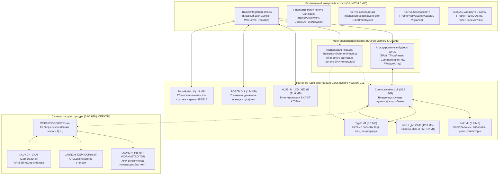

> Уточнение 25.10.2026: это первоначальный обзор, его полнота и перечисленные ABI требуют проверки по исходникам. В актуальном хосте движение рассчитывает managed LTD; POEZD используется только как изолированный производитель тормозной силы. Действующая реализация и ограничения описаны в [TRAIN_DYNAMICS_IMPLEMENTATION.md](TRAIN_DYNAMICS_IMPLEMENTATION.md). Автоведение и полное соответствие РЭ не приняты.

# Архитектура и детальный разбор модулей тренажера 2ЭС6 (Native & Managed)

Настоящий документ содержит полный технический разбор программного комплекса тренажера электровоза **2ЭС6 «Синара»** с грузовым составом (75 вагонов, 6000 т). Разобраны все оригинальные нативные модули (Delphi XE2 / x86 DLL), управляемая интеграционная оболочка (C# .NET Framework 4.0) и инфраструктурные сценарии (PowerShell).

---

## 1. Общая архитектурная карта системы

Комплекс построен по многослойной схеме. Исторически он разрабатывался ЗАО НПЦ «СПЕКТР» (г. Екатеринбург) как распределенный аппаратно-программный класс (сервер + АРМ инструктора + АРМ ДСП + тренажер машиниста с аппаратным пультом). В текущей реализации математическое ядро локомотива интегрировано в переносимый C# хост.



---

## 2. Разбор оригинальных нативных пакетов (`work/native_distribution/`)

Все бинарные файлы оригинального дистрибутива собраны компилятором **Borland Delphi / Embarcadero C++ Builder (XE2)** под целевую архитектуру **Win32 (x86, 32-bit PE)**.

### 2.1. `LAUNCH_CAM` — АРМ внешнего обзора и 3D-камер
* **Технологический стек**: Delphi XE2, WinForms/VCL, сокеты TCP/IP.
* **Содержимое**:
  * `LauncherClient.exe` (3.34 МБ) — клиентский запуск рабочего места.
  * `RESOURCES/Camera3D.dll` — модуль обработки положений камер (машинист, сцепка, хвостовой вагон, станционные опоры).
  * `PROPERTY/ClientProperty.prop` — бинарная конфигурация (UTF-16LE строки):
    * IP-адрес сервера: `192.168.1.111`;
    * Имя клиента: `2-!6` (2ЭС6);
    * DLL: `Camera3D.dll`;
    * Путь к внешнему рендеру: `D:\3D\Trenager\main.exe`;
    * Скрипт подстройки: `camAdjustClient.bat`.
* **Как устроено взаимодействие**: клиент подключается к `WORLD3DServer`, получает текущие координаты локомотива и вагонов в реальном времени и должен транслировать их во внешнее графическое приложение `main.exe` через IPC/память.

---

### 2.2. `LAUNCH_DSP` — АРМ Дежурного по станции
* **Технологический стек**: Delphi XE2, 2D-векторная графика VCL, сетевой обмен.
* **Содержимое**:
  * `LauncherClient.exe` (3.34 МБ) — запуск клиента с ролью ДСП.
  * `RESOURCES/DCPult.dll` (4.41 МБ) — библиотека пульта электрической централизации (ЭЦ) станции.
  * Файлы схем станций: `.dsp` (векторное описание путевого развития, стрелок, изостыков, светофоров и кнопок приготовления маршрутов).
* **Реализация**: оператор видит пульт-табло станции. При нажатии кнопок задания маршрута `DCPult.dll` проверяет зависимости ЭЦ (свободность стрелочно-путевых секций, положение стрелок) и отправляет серверу команды на перевод стрелочных электроприводов и открытие выходных/входных светофоров.

---

### 2.3. `LAUNCH_INSTR` & `WORKNETEDITOR` — АРМ Инструктора
* **Технологический стек**: Delphi XE2, VCL GUI, базы данных paradox/custom binary.
* **Содержимое**:
  * `LauncherClient.exe` + `RESOURCES/InstructorW3D_XE2.dll` (19.02 МБ) — интерфейс управления учебным процессом.
  * Подпапка `WORKNETEDITOR`:
    * `EditFault3DScenNet.exe` (11.1 МБ) — сетевой редактор и генератор неисправностей (обрыв цепей ТЭД, заклинивание колесной пары, утечка ТМ, залипание контактора).
    * `EditBrakeScenaries.exe` (12.5 МБ) — редактор сценариев торможения.
    * `EditDBTrain.exe` (13.0 МБ) — конструктор составов (выбор типа вагонов: 4-осные, 8-осные, порожние, груженые, тип колодок: чугун/композиция).
    * `ViewProtokol.exe` (15.9 МБ) — экспертная система оценки действий машиниста. Анализирует скоростемерные ленты формата `.lenta` (в поставке: `Лента_Ибрагимов_2.lenta` на 58 МБ). Фиксирует превышения скорости, проезды запрещающих сигналов, завышение давления в ТМ, разрыв поезда, реакции по автосцепкам.

---

### 2.4. `LAUNCH_TREN` — Сетевой клиент тренажера машиниста
* **Технологический стек**: Delphi XE2.
* **Содержимое**:
  * `LauncherClient.exe` + `RESOURCES/Trenager.dll` (17.91 МБ).
  * `WorldsSettings.wset` — реестр миров.
* **Протокол обмена**:
  * Экспорты: `InitClientDll`, `CloseClientDll`.
  * Клиент собирает структуру `TTrenToServer` (56 байт): положения контроллера машиниста (КМ), крана вспомогательного тормоза (КвТ), реверсивной рукоятки, тумблеров, кнопок РБ/РБС, сигналов ЭПК.
  * Сервер возвращает `TServerToLoco` / `TServerToTren`: скорость движения, путевую координату, уклоны профиля, показания АЛСН/КЛУБ, сигналы светофоров.

---

### 2.5. `WORK_TRENAGER_3D` — Локальное ядро локомотива 2ЭС6
Основной рабочий каталог нативной симуляции электровоза 2ЭС6.

| DLL / Модуль | Размер | Экспорты / Точки входа | Назначение и структуры данных |
|---|---:|---|---|
| `RESOURCES/LOCOMOTIVES/1/Communication1.dll` | 29.5 МБ | `InitCommunication`, `ExecuteCommunication`, `CloseCommunicationDll` | **Ядро тренажера**. Выделяет и держит в памяти базовые структуры: `TPult` (состояния органов управления кабины), `TTygaParam` (электрические параметры тяги), `PWagonArray` (массив 75 вагонов), `TCommonBtn`. Управляет внутренними потоками обмена. |
| `RESOURCES/LOCOMOTIVES/1/Pult1.dll` | 8.4 МБ | Загружается через `Communication1.dll` | Имитация низковольтных и высоковольтных цепей 2ЭС6: быстродействующий выключатель (БВ), контакторы, промежуточные реле, тумблеры пульта, преобразователи СТПР, МПК, шкафы МСУ-Л. |
| `RESOURCES/LOCOMOTIVES/1/Tyga1.dll` | 8.2 МБ | Загружается через `Communication1.dll` | Математика тяговых электродвигателей постоянного тока с последовательным/независимым возбуждением (ТЭД 2ЭС6). Расчет токов якоря ($I_a$), токов возбуждения ($I_v$), противо-ЭДС, температур обмоток, силы тяги ($F_{тяги}$) и электрического торможения. |
| `RESOURCES/LOCOMOTIVES/1/MSUL_MON.dll` | 12.3 МБ | Вызывается из `Communication1.dll` | Отрисовка графических экранов микропроцессорной системы управления (МСУ-Л / МПСУ-ИД): кадры ДИАГНОСТИКА, ТЯГА, ПНЕВМАТИКА, ЭНЕРГИЯ, СООБЩЕНИЯ. |
| `RESOURCES/KLUB_U_LCD_XE2.dll` | 20.7 МБ | `InitKlub_U_LCD`, `ProceedKlub`, `CloseKlub`, `GetParamInToKLUB` | Эмуляция дисплея БИЛ-УТ аппаратуры КЛУБ-У: цифровая индикация фактической и допустимой скорости, целевой скорости, давления в ТМ/УР/ТЦ, несущей частоты АЛСН, координаты, времени, графическая шкала ускорения. |
| `RESOURCES/POEZD.DLL` | 124 КБ | `InitPoezd`, `ProceedPoezd`, `SetProf`, `SetPlan`, `SetPosition` | Численное интегрирование уравнений движения поезда по второму закону Ньютона: $a = \frac{F_k - W_0 - B_t}{m}$. Учитывает основное сопротивление движению электровоза и вагонов, сопротивление от уклонов и кривых. |
| `RESOURCES/TormModel.dll` | 1.75 МБ | `ProceedTorm`, внутренние шаги ВР | Пневматическая модель: тормозная магистраль (ТМ), питательная магистраль (ПМ), запасные резервуары (ЗР), тормозные цилиндры (ТЦ), воздухораспределители усл. № 483, краны машиниста усл. № 395 и 215. |
| `RESOURCES/AVP.dll` | 10.3 МБ | Функции шага автоведения | Автоматическое ведение грузового поезда: расчет оптимальной траектории движения, выбор позиций ослабления поля, управление тягой и пневматическим торможением по энергооптимальному графику. |
| `RESOURCES/VideoHandle.dll` | 1.9 МБ | `InitVideoModule`, `GoVideo`, `SetLightersState`, `Set3DObjectParam` | Видеомодуль оверлея DirectX 8 поверх оцифрованного видеопотока перегона. |

---

### 2.6. `WORLD3DSERVER` — Сетевой сервер виртуального мира
* **Технологический стек**: Delphi XE2 x86, сетевые сокеты Winsock/Indy.
* **Содержимое**:
  * `WORLD3DServer.exe` (5.28 МБ) — многопоточный сервер симуляции.
  * `EditorPultDNC.exe` (5.15 МБ) — АРМ поездного диспетчера (ДНЦ участка).
  * `ReestrW3D.exe` (9.55 МБ) — менеджер виртуальных полигонов.
  * Каталог `DATA/WORLDS/`:
    * Полигоны: `Kunara-Kosulino`, `World-Skils`, `NovyiUrengoy`, `Липецк`, `Nikitino`.
    * Файлы графа пути: `.dncsrv` (топология путей, стрелок, светофоров, изолированных участков).
    * `WayDamp/wayDump.ways` — координаты и длины перегонных путей;
    * `wayDump.switches` — стрелочные переводы и направления;
    * `wayDump.lights` — светофоры и их типы.

---

## 3. Разбор управляемых модулей C# (`outputs/`)

Управляемый слой написан на **C# (.NET Framework 4.0, target: x86)**. Его назначение — инкапсулировать вызовы нативных DLL, исключить зависимость от реального «железа» кабины (ВВТ, аппаратных COM-портов) и обеспечить изолированное воспроизводимое выполнение физических сценариев.

### Архитектурная группировка C# исходников:

#### 1. Хост, ядро и интерфейс (Core Host & GUI)
* **[`TrainerIntegrationHost.cs`](file:///c:/Users/sibir/Desktop/Макрос/Тренажер/outputs/TrainerIntegrationHost.cs)**:
  * Аллоцирует блоки неуправляемой памяти (`Marshal.AllocHGlobal`) под все структуры Delphi (`TPult`, `TTygaParam`, `TCommunicationRec`, `PWagonArray`, `TLocParam` и др.) с точным байтовым выравниванием.
  * Вызывает `InitCommunication`, `InitKlub_U_LCD`, `LoadRoute`.
  * Запускает высокоточный таймер на 100 мс (10 Гц), синхронизирующий все физические и логические циклы.
  * Рендерит WinForms-интерфейс пульта управления 2ЭС6, переключатели, тумблеры, вольтметры/амперметры.
* **[`TrainerRouteDOS.cs`](file:///c:/Users/sibir/Desktop/Макрос/Тренажер/outputs/TrainerRouteDOS.cs)** & **[`TrainerRouteView.cs`](file:///c:/Users/sibir/Desktop/Макрос/Тренажер/outputs/TrainerRouteView.cs)**:
  * Загружают профиль и план линии (участок *Войновка — Кокшаровский*, [`Voynovka_Koshkarovsky_route.json`](file:///c:/Users/sibir/Desktop/Макрос/Тренажер/outputs/Voynovka_Koshkarovsky_route.json)).
  * Транслируют уклоны и радиусы кривых в `POEZD.DLL` через `SetProf`/`SetPlan`.
  * Рендерят отдельное окно режимной карты машиниста с масштабированием, профилем пути, пикетами и предупреждениями.
* **[`TrainerSessionLogging.cs`](file:///c:/Users/sibir/Desktop/Макрос/Тренажер/outputs/TrainerSessionLogging.cs)**:
  * Потокобезопасное структурированное логирование сессий, телеметрии и исключений.

#### 2. Пневматическая система (Физика воздуха и кранов)
* **[`TrainerAirNetwork.cs`](file:///c:/Users/sibir/Desktop/Макрос/Тренажер/outputs/TrainerAirNetwork.cs)**:
  * Базовая модель термодинамики сжимаемого воздуха: резервуары, сопла, перепускные клапаны, учет массы воздуха (кг) и давлений (кгс/см² и Па).
* **[`TrainerControlAir.cs`](file:///c:/Users/sibir/Desktop/Макрос/Тренажер/outputs/TrainerControlAir.cs)**:
  * Цепи управления воздухом локомотива: резервуары РС6 (55 л) и РС7 (150 л), кран вспомогательного компрессора КМ2, редукторы, электропневматические клапаны (КЕП11).
* **[`TrainerBtoNetwork.cs`](file:///c:/Users/sibir/Desktop/Макрос/Тренажер/outputs/TrainerBtoNetwork.cs)**:
  * Блок тормозного оборудования (БТО 2ЭС6): моделирует реле давления тележек, переключательные клапаны, раздельное торможение первой и второй секции.
* **[`TrainerKvtProfile.cs`](file:///c:/Users/sibir/Desktop/Макрос/Тренажер/outputs/TrainerKvtProfile.cs)**:
  * Таблица положений крана вспомогательного тормоза усл. № 215 (ступени торможения и отпуска).
* **[`TrainerTwoSectionAirChain.cs`](file:///c:/Users/sibir/Desktop/Макрос/Тренажер/outputs/TrainerTwoSectionAirChain.cs)**:
  * Межсекционная воздушная магистраль, объединение питательных резервуаров двух секций.
* **[`TrainerPneumaticTiming.cs`](file:///c:/Users/sibir/Desktop/Макрос/Тренажер/outputs/TrainerPneumaticTiming.cs)**:
  * Квантование времени: согласование шага 1/30 с нативной `TormModel.dll` с общим циклом 100 мс хоста.
* **[`TrainerTrainPressureView.cs`](file:///c:/Users/sibir/Desktop/Макрос/Тренажер/outputs/TrainerTrainPressureView.cs)**:
  * Диагностическое окно: таблица и пространственный график распределения давления в ТМ, ТЦ и ЗР по всем 75 вагонам поезда в реальном времени.

#### 3. Модификации в оперативной памяти (In-Memory Patching)
* **[`TrainerNativeFixes.cs`](file:///c:/Users/sibir/Desktop/Макрос/Тренажер/outputs/TrainerNativeFixes.cs)**:
  * Механизм безопасного динамического изменения байтов кода в памяти процесса (`VirtualProtect` -> запись патча -> восстановление флагов).
  * Обязательный SHA-256 контроль оригинальных библиотек и байтовые гарды (проверка байтов перед заменой).
  * Исправление знаковой скорости в `Tyga1.dll` (устранение ошибки скатывания назад).
  * Коррекция раскладки кадров МСУ-Л в `MSUL_MON.dll`.
* **[`TrainerNativeBrakeRelease.cs`](file:///c:/Users/sibir/Desktop/Макрос/Тренажер/outputs/TrainerNativeBrakeRelease.cs)** & **[`TrainerSa47MemoryPatch.cs`](file:///c:/Users/sibir/Desktop/Макрос/Тренажер/outputs/TrainerSa47MemoryPatch.cs)**:
  * Реализация кнопки отпуска локомотивного тормоза **SA47**: сброс давления в ТЦ электровоза при зажатых автоматических тормозах поезда без перезаписи DLL на диске.

#### 4. Системы безопасности и автоведение
* **[`TrainerKlubSafetyBinding.cs`](file:///c:/Users/sibir/Desktop/Макрос/Тренажер/outputs/TrainerKlubSafetyBinding.cs)** & **[`TrainerNativeSafetyAdapter.cs`](file:///c:/Users/sibir/Desktop/Макрос/Тренажер/outputs/TrainerNativeSafetyAdapter.cs)**:
  * Адаптер кодов АЛСН (З, Ж, КЖ, К), передача параметров скорости и ускорения в БИЛ-УТ КЛУБ-У.
* **[`TrainerVigilanceOperatorControls.cs`](file:///c:/Users/sibir/Desktop/Макрос/Тренажер/outputs/TrainerVigilanceOperatorControls.cs)**:
  * Логика проверки бдительности: рукоятки РБ (основная) и РБС (верхняя/специальная), периодический и однократный контроль, срыв ЭПК при неподтверждении.
* **[`TrainerAutovedenieController.cs`](file:///c:/Users/sibir/Desktop/Макрос/Тренажер/outputs/TrainerAutovedenieController.cs)** & **[`TrainerTrainBrakeCycle.cs`](file:///c:/Users/sibir/Desktop/Макрос/Тренажер/outputs/TrainerTrainBrakeCycle.cs)**:
  * Цифровой контур автоведения грузового поезда: ПИД-регулирование тяги и ступени торможения по расчетным кривым скорости.

---

## 4. Спецификация структур данных Delphi (ABI Interop)

Для успешного взаимодействия C# с нативными библиотеками критически важно соблюдение точной бинарной раскладки структур в памяти.

### Основные структуры Delphi (Pack = 1):

```csharp
// Заголовок связи Communication (37 байт)
// RVA смещения в TCommunicationRec:
[StructLayout(LayoutKind.Sequential, Pack = 1)]
public struct TCommunicationRec {
    public IntPtr PCommonBtn;          // +0x00: указатель на кнопки
    public IntPtr PResTyga;            // +0x04: указатель на результат тяги
    public IntPtr PLocParam;           // +0x08: параметры локомотива
    public IntPtr PVagonParam;         // +0x0C: параметры вагонов
    public IntPtr PInputParamPult;     // +0x10: входные параметры пульта
    public IntPtr POutParamAllTRen;    // +0x14: выходные параметры тренажера
    public IntPtr PProfilCPE;          // +0x18: профиль пути
    public IntPtr PWagonArray;         // +0x1D: массив 75 вагонов
    public IntPtr PPultParamOutRecord; // +0x21: выход пульта
}

// Элемент массива вагонов (243 байта на вагон)
// Offset 0x25: масса вагона в тоннах (int = 80)
// Offset 0x11: давление в ТМ (float)
// Offset 0x15: давление в ТЦ (float)
// Offset 0x19: давление в ЗР (float)
```

---

## 5. Практическое руководство: как запускать и использовать

### 5.1. Управление через CLI ([`trainer.cmd`](file:///c:/Users/sibir/Desktop/Макрос/Тренажер/trainer.cmd))

| Действие | Команда | Назначение |
|---|---|---|
| **Диагностика** | `.\trainer.cmd -Action Doctor` | Проверка доступности компилятора C#, зависимостей, контрольных сумм 51 нативной DLL |
| **Сборка** | `.\trainer.cmd -Action Build` | Компиляция C# источников в `outputs/TrainerIntegrationHost.exe` (профиль `candidate`) |
| **Тестирование** | `.\trainer.cmd -Action Test -Suite regression` | Последовательный прогон автоматических регрессионных проб |
| **Интерактивный пуск** | `.\trainer.cmd -Action Run` | Сборка, деплой и запуск тренажера с графическим интерфейсом кабины 2ЭС6 |
| **Фиксация правок** | `.\trainer.cmd -Action Fix -Name "name" -Note "описание"` | Автоматическая сборка, прогон тестов и фиксация в чекпоинт |

### 5.2. Правила модификации и расширения
1. **Код тренажера** пишется строго на **C#** в каталоге [`outputs/`](file:///c:/Users/sibir/Desktop/Макрос/Тренажер/outputs).
2. **Скрипты автоматизации** пишутся строго на **PowerShell** в каталоге [`dev/`](file:///c:/Users/sibir/Desktop/Макрос/Тренажер/dev).
3. **Нативные DLL на диске никогда не изменяются**. Если требуется скорректировать поведение закрытой DLL (как с SA47 или знаковой скоростью), правка оформляется как in-memory патч в [`TrainerNativeFixes.cs`](file:///c:/Users/sibir/Desktop/Макрос/Тренажер/outputs/TrainerNativeFixes.cs) с контролем SHA-256 и байтовыми гардами.
