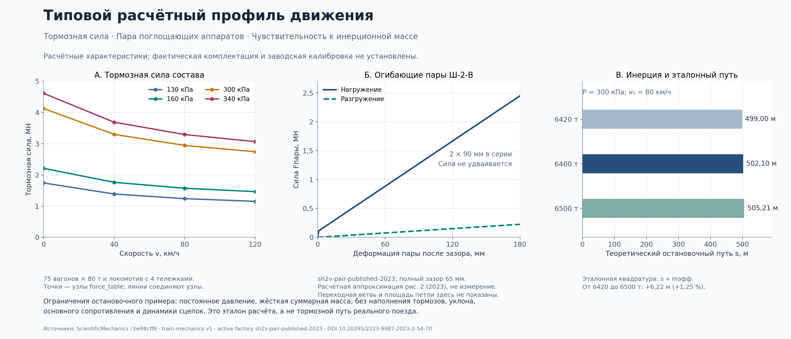

# Научный расчётный профиль движения 2ЭС6

25 октября 2026 года. Пользователь выбрал типовой расчётный профиль для нынешнего состава: двухсекционный локомотив 200 т и 75 четырёхосных гружёных вагонов по 80 т с композиционными колодками. Идентификатор: **2es6-75x80t-scientific-reference-v1**.

Настройки находятся в [train-mechanics.json](../config/train-mechanics.json). Физическая масса, давление, приведённая масса вращающихся частей и усилие на одну колодку разделены. Источники параметров и результаты расчётов сохранены рядом с [квитанцией проверки](audit_parts/scientific_mechanics_20261025/receipt.json).

## Вращающаяся инерция

Из равенства поступательной и вращательной кинетической энергии:

$$m_{\rm rot}=\sum_j n_jJ_j(\omega_j/v)^2,\qquad m_{\rm eff}=m+m_{\rm rot},\qquad E=\tfrac12m_{\rm eff}v^2.$$

Для колеса отношение равно 1/r, для постоянно связанного с колесом ротора — g/r. Передаточное число входит в приведённую массу в квадрате; отключение тяги не устраняет механически связанный ротор из инерции. Код поддерживает расчёт по заданным моментам инерции без выдумывания паспортных J.

Для выбранного типового гружёного состава приняты литературные оценки γ локомотива 0,25 и вагона 80 т 0,035. Это даёт 50 т приведённой массы локомотива и 2,8 т на вагон, всего 260 т. При физических 6200 т инерционная масса равна **6460 т**. В уравнениях силы тяжести и сопротивления используется физическая масса; в ускорении и кинетической энергии — приведённая.

Диапазоны чувствительности γ локомотива 0,20–0,30 и гружёного вагона 0,03–0,04 дают 6420–6500 т. Это не идентификация роторов конкретного электровоза или произвольного порожнего вагона.

Основания: энергетическая методика EN 14531-1 §4.3.2.3–4.3.2.5; раздельные множители локомотива и вагонов в [Mašek, Lenoch, Lelek, 2016, таблица III](https://ojs.cvut.cz/ojs/index.php/TEE/article/download/3871/3673); гружёный/порожний состав в [Аблялимов, ТашИИТ, 2016, лекция 12](https://api.ziyonet.uz/uploads/books/1086763/5affb597de2d4.pdf?exVkJALeMUqqr0brDWIbA=). Подробное разграничение первичных методик и оценочных коэффициентов: [исследование](audit_parts/scientific_mechanics_20261025/inertia-research.json).

## Сцепка и поглощающие аппараты

Включена типовая модель **пары Ш-2-В**, воспроизводящая опубликованную расчётную характеристику межвагонной связи. Один link ядра представляет два аппарата последовательно:

$$x_{\rm pair}=2x_{\rm gear},\quad F_{\rm pair}=F_{\rm gear},\quad k_{\rm pair}=k_{\rm gear}/2,\quad E_{\rm pair}=2E_{\rm gear}.$$

Рабочий ход пары — 180 мм, одного аппарата — 90 мм. Полный свободный интервал 65 мм перенесён из исходной односторонней координаты в нейтральную координату ядра ±32,5 мм; зазор не прибавляется повторно к рабочему ходу.

| Параметр пары | Расчётное значение |
| --- | ---: |
| Нагрузочная огибающая после контакта | 100 кН + 13,05556 МН/м × x |
| Разгрузочная огибающая | 1,25 МН/м × x |
| Сила в конце рабочего хода 180 мм | около 2,45 МН |
| Переходная жёсткость при запертой разгрузке | около 100 МН/м |
| Жёсткость после закрытия | 100 МН/м |
| Регуляризация входа в контакт | 1 мм |

Переходная жёсткость отделена от численного сглаживания контакта. Состояние внутреннего трения переносится между подшагами; проверяются запасённая энергия и неотрицательная диссипация. Симметричное продолжение на растяжение и нейтральное начальное положение явно являются допущениями профиля.

Источник — [Беспалько, Жухин, Пудовиков, 2023, рисунок 2, страницы 57–59](https://atjournal.ru/ru/storage/download/122759), DOI 10.20295/2223-9987-2023-2-54-70. Оцифрованные точки, графическая неопределённость и разграничение с паспортными требованиями к аппаратам: [исследование](audit_parts/scientific_mechanics_20261025/coupler-research.json). Рисунок публикации представляет научную расчётную модель; он не объявляется заводской измеренной характеристикой установленного оборудования.

## Тормозные силы

Производственный расчёт больше не использует агрегированный коэффициент нажатия старой POEZD как тормозную силу. Из штатной пневматики берутся реальные давления всех 75 вагонов и четырёх тележек локомотива. Давление интерфейса кгс/см² переводится в Па через 98066,5.

Для группы одинаковых цилиндров:

$$A=\pi D^2/4,\quad F_{\rm rod}=\max(pA\eta_c-F_1-F_2,0),$$
$$N_\Sigma=F_{\rm rod}\,n\,\eta_r\,N_c,\quad K=N_\Sigma/N_s,\quad B=N_\Sigma\varphi(K/1000,3.6|v|).$$

Здесь K — действительное нажатие на **одну** колодку в ньютонах; аргумент формулы трения K/1000 выражен в кН. Передаточное число n относится к сумме нажатий от одного цилиндра. Потери пружин относятся к одному штоку и вычитаются до умножения на рычажное отношение и число цилиндров.

| Параметр | Типовой вагон | Одна тележка локомотива |
| --- | ---: | ---: |
| Цилиндры | 2 × 254 мм | 4 × 203 мм, типовой 670В |
| Колодки | 8 композиционных | 8, типовая локомотивная M-кривая |
| Общее рычажное отношение на цилиндр | 5,70 | 8,8 |
| КПД цилиндра / передачи | 0,98 / 0,95 | 0,98 / 0,95 |
| Усилие возвратной пружины на цилиндр | 1032,5 Н | 1200 Н |
| Приведённое усилие регулятора на цилиндр | 512,77 Н | отдельный внешний регулятор не задан |

Вагонный набор — расчётный пример эффективности из приложения Г ГОСТ 34434-2018 при максимальном ходе штока 65 мм. Это выбранный механический эквивалент: прежние 994 см²/5,79 не выдаются за его геометрию. Действующий производитель давления и эффективный воздушный объём пневматической модели сохраняются; их новая идентификация не заявляется.

Для локомотива используются четыре отдельных давления, 16 цилиндров и 32 колодки. Нелинейная сила сначала считается по каждой тележке и лишь затем суммируется. Усреднение давлений перед расчётом силы не применяется.

Для композиционной колодки:

$$\varphi=0.44\,\frac{0.1K_{\rm kN}+20}{0.4K_{\rm kN}+20}\,\frac{v_{\rm km/h}+150}{2v_{\rm km/h}+150}.$$

Для выбранной типовой локомотивной M-кривой:

$$\varphi=0.5\,\frac{1.6K_{\rm kN}+100}{5.2K_{\rm kN}+100}\,\frac{v_{\rm km/h}+100}{5v_{\rm km/h}+100}.$$

Расчётное приведённое нажатие и расчётный коэффициент трения не смешиваются с этой цепочкой действительного нажатия. Пневматический авторежим и механический регулятор рычажной передачи — разные устройства; усилие последнего не выводится из бита AR1.

Источники: [официальное издание ГОСТ 34434-2018, §8.3.2.6 и приложение Г](https://ksm.kz/media/coreapp/gostdiscussion/ed5_ru_1_1778_2014_g34434_2018.pdf); [Синицын, Кобищанов, 2020, страница 23: 670В, КПД и пружина](https://bstu.editorum.ru/en/storage/download/49957); [Галай, Рудов, Галай, 2017, страницы 5–8: локомотивная M-кривая](https://cctvcad.com/Files/VestnikBelGUT20172.pdf). Полные ссылки, изображения проверенных страниц, ограничения материала/геометрии и независимые численные примеры: [исследование](audit_parts/scientific_mechanics_20261025/brake-research.json).

## Проверочные расчёты и сквозная работа

По таблице Г.9 независимо воспроизводятся минимальные нажатия на колодку: 6,64716 кН при 130 кПа и 18,07518 кН при 300 кПа. Максимумы той таблицы используют другие предпосылки потерь; совпадение с ними для одного фиксированного профиля не подгоняется.

При 300 кПа и 80 км/ч выбранный профиль даёт 37,80496 кН на вагон, 110,97393 кН на локомотив, всего 2,94635 МН. Для отдельного проверочного стенда с постоянным одинаковым давлением и одной эквивалентной массой:

$$t=\int_0^{v_0}m_{\rm eff}/B(v)\,dv,\qquad s=\int_0^{v_0}m_{\rm eff}v/B(v)\,dv.$$

Независимое интегрирование Симпсона даёт 42,94471 с и 502,10426 м. Это **постоянное давление, ровный путь, без сопротивления движению и колебаний сцепок**. Результат не объявляется тормозным путём реального поезда с наполнением ТЦ. Ошибка решателя при шагах 0,04/0,02/0,01/0,005 с убывает примерно вдвое: 0,5024/0,2512/0,1256/0,0628 м. Допуск проверки энергетической невязки выведен из допуска решателя, отдельно от фактической тормозной работы.

Свежие 11 целевых проб проверяют формулы, пассивность, знаки, сходимость, настройку профиля и реальный контур хоста. В сквозной пробе используются настоящий старт от Tyga, команды КМ V/IV/II, реальные давления, общий источник скорости приборов и сбросы начальных условий. Принудительные давления, токи или силы для прохождения этого сценария не задаются. Старый native brake oracle сохранён как исторический диагностический компонент и не является источником производственной тормозной силы.

Точные сборки, результаты, закрытие сессий, хэши конфигурации и исходников: [квитанция](audit_parts/scientific_mechanics_20261025/receipt.json). Полный исторический regression не переименовывается в приёмку новой модели.

## Границы применения и запуск

Это согласованный **типовой расчётный профиль**, выбранный пользователем. Фактические модели вагонов, материал конкретных локомотивных колодок, износ, температура, мокрый контакт, юз, полная калибровка пневматики/тормозного пути и точная комплектация РЭ №137+ требуют своих исходных данных и проверок. АВП остаётся недопущенным до новой эксплуатационной тормозной калибровки.

Все параметры доступны в настройках профиля и исходниках. Стандартный запуск из корня: trainer.cmd -Action Run. Этот путь пересобирает текущий исходный код и развёртывает его в outputs. Исходные файлы DLL и установка на диске E не изменяются.
