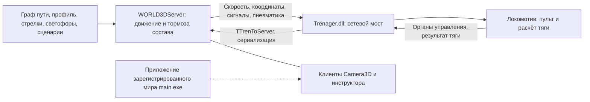
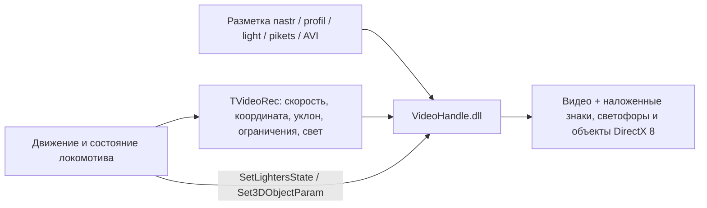

# Разметка, 3D-мир и связь с тренажёром

Статическое исследование от 13.10.2026. Найдены две отдельные ветки: сетевой виртуальный мир и видеомаршрут с графическими наложениями. Работающий C# стенд сейчас рассчитывает движение по своему PDF-маршруту; явного сетевого или графического моста к этим веткам в его исходниках нет. Запуск 3D, сетевой обмен и отрисовка в этом исследовании не проверялись.

## Где находятся данные

Все пути ниже отсчитываются от корня рабочей среды.

| Область | Путь | Содержание |
|---|---|---|
| Разметка видео | `work/native_distribution/WORK_TRENAGER_3D/RAZMETKA` | Екатеринбург–Тюмень, Войновка–Екатеринбург, Курган–Петропавловск; 150 файлов |
| Серверная копия видеоразметки | `work/native_distribution/WORLD3DSERVER/DATA/RAZMETKA` | Разметка и результаты; 160 файлов |
| Отдельный видеомаршрут | `work/native_distribution/WORLD3DSERVER/Vazma-Moskva` | Разметка, сценарии и редакторы; 48 файлов |
| Реестр 3D-миров | `work/native_distribution/WORLD3DSERVER/DATA/WORLDS/WorldsSettings.wset` | Две зарегистрированные записи и ссылки на приложения/серверные данные |
| Граф пути и диспетчерские схемы | `work/native_distribution/WORLD3DSERVER/DATA/WORLDS` | `.dncsrv`, `.dsp`, `WayDamp`, `WayInit.dat`, `VARIANTS`; 178 файлов |
| Сценарии мира | `work/native_distribution/WORLD3DSERVER/DATA/SCENARIES3D` | `ScenariesManager.sman`, три `.scen`; реестр содержит два сценария |
| Составы | `work/native_distribution/WORLD3DSERVER/DATA/DBTRAINS` | `Trains.dbtrain`, десять `DATA/*.train` |

`WorldsSettings.wset` разобран полностью: 780 байт. Записи:

| Имя в реестре | Приложение | Серверные данные | Диспетчерские схемы |
|---|---|---|---|
| Корнильцево-Буйловск | `Kornilcevo/main.exe` | `Kunara-Kosulino/Kunara-Kosulino.dncsrv` | `Kunara.dsp`, `Boyci.dsp`, `Pervouralsk.dsp`, `Kunara-Kosulino.dsp`, `Standart.dsp` |
| WorldSkils | `WorldSkils/main.exe` | `World-Skils/ServerWS.dncsrv` | `World-Skils.dsp`, название «Воронеж-Грязи» |

Оба `.dncsrv` и все шесть `.dsp` присутствуют. Имена приложений — ссылки из реестра, его базовый путь приложения из одного файла не установлен. Наличие записи не доказывает выбор этого мира в текущей сессии. Другие каталоги миров не являются дополнительными записями этого реестра.

## Как устроена разметка

У видеомаршрута `.nastr` связывает `.video`, `.profil`, `.plan`, `.light`, `.arrow`, `.stan`, `.signs`, `.pereezd`, `.sautpnt`, `.othobj`, `.prep`, `.pikets`. Это CP1251 manifest. Например, `RAZMETKA/Ekat - Tumen/kanerinburg - Tumen.nastr`, строки 3–14, перечисляет эти файлы.

`.vidproj` того же маршрута явно называет 187 светофоров, 3311 пикетов, 202 элемента профиля, 240 кривых, 204 стрелки, 463 цели КЛУБ/САУТ и другие категории. В строке 5 сохранён путь `D:\Avi/`. В заголовке `.video` обнаружены ссылки на 11 AVI, а не геометрия полного 3D-мира.

Проверены форматы нескольких файлов, без чтения большого видеомассива:

| Файл | Проверенное представление | Предел трактовки |
|---|---|---|
| `.pikets` | `New` UTF-16LE; version u32 @6, count @10, записи @14 по 17 байт `<iiiiB>`; 3311 записей | Первые числа похожи на путь/км/пикет. Четвёртый int может быть номером кадра; единицы не установлены |
| `.profil` | Такой же header; 202 записи по 12 байт `<fff>` | Начало/длина/уклон — вывод по числам и назначению файла, без найденной схемы типов |
| `.arrow`, `.plan`, `.stan`, `.signs` и прочие малые таблицы | CP1251 текст, заявленные counts совпали с числом строк и полей | Все единицы и значения enum ещё не установлены |
| `WayDamp/wayDump.ways` | Текстовый граф; в World-Skils 300 записей по 5 строк | Связи endpoint/направлений и длина — структурная интерпретация |
| `wayDump.switches` | 200 записей по 3 строки, 50 префиксов имени и четыре сочетания направлений | Это не доказательство 200 физических стрелок; вероятны 50 узлов с четырьмя сочетаниями |
| `wayDump.lights` | 415 записей по 5 строк с уникальными именами | Count не доказывает активность объектов или смысл типов 6/9/11 |

Во всех 11 наборах `WayDamp` проверены размеры 33 текстовых таблиц. Формат `waysys.bin` полностью не разобран. В Kunara его первое u32 равно 204, а соседний `.ways` содержит 210 записей; считать эти представления автоматически синхронными нельзя.

Для редактирования найдены `VideoReg.exe`, `VideoRegStream.exe`, `EditVideoScenNet.exe`, `EditorPultDNC.exe`, `ReestrW3D.exe`, `EditFault3DScen.exe`, `EditFault3DScenNet.exe` и редакторы библиотеки/нарушений. Их работа запуском не проверялась.

## Сетевой виртуальный мир

Сплошные связи основаны на типах и выбранных вызовах. Последняя пунктирная связь обозначает внешнюю зависимость визуального приложения: её успешный запуск/подключение не установлен.

Сетевые плагины `LAUNCH_TREN/RESOURCES/Trenager.dll` и `LAUNCH_CAM/RESOURCES/Camera3D.dll` экспортируют `InitClientDll` и `CloseClientDll`. В `Trenager.dll` по TD32 и инструкциям подтверждена цепочка:

`TManagerTrenagerDllClass.GetSetDataServer` → `TLocomotive.GetDataTrenToServer` → `TClientDllOwner.ToFromServerDATA` → `TProceedTren.SetDataServerToTren` → `ProceedAll`.

Пример адресов RVA: `GetSetDataServer 0x3b9e2c`; вызовы сбора/обмена/применения данных — `0x3b9e92`, `0x3b9e9f`, `0x3b9ed4`. Полученные данные задают динамику вагонов, текущую скорость, путевую координату и коды направлений.

**В этой ветке расчётом состава владеет сервер.** В `WORLD3DServer.exe`:

| Метод, VA | Подтверждённые вызовы |
|---|---|
| `TTrainW3D.ProceedTTrain 0x735af4` | `TTrain.ProceedTTrain 0x68bbec`, работа POEZD, неисправности, сценарии |
| `InitPoezdDll 0x7322dc` | `GetProf 0x703bc0`, `AddProfil 0x723e84`, `AddPlan 0x723e50`, `SetPosition 0x7252ac`, `ProceedTPoezdDll 0x72477c` |
| `TTrain.ProceedTTrain 0x68bbec` | `ProceedTorm 0x68359c` |

Тип `TTrainW3D` хранит путь, направления, профиль, ограничения, светофоры, пневматику, POEZD и сценарии. Все VA/RVA относятся только к SHA-файлам, записанным в evidence.

| Направление | Типизированные данные |
|---|---|
| Клиент → сервер | `TTrenToServer`: положения КМ/КвТ/ВЦУ/реверса, результат тяги, ЭПК/ЭПТ/ЭДТ и кнопки |
| Сервер → клиент | `TServerToLoco`/`TServerToTren`: скорость, координата, коды чётного/нечётного направлений, пневматика и состояния вагонов |
| Инфраструктура | Профиль/план, ограничения, светофоры, знаки и изменения элементов ДНЦ |

`TPositionLoc` в этих типах — положения органов управления, **не XYZ**. Размеры записей RTTI, включая `TTrenToServer 56` и `TServerToLoco 26`, описывают память процесса. В них есть указатели; отправлять их как готовые сетевые пакеты нельзя. Полный wire format, длины сериализации и кадрирование не разобраны.

## Видеомаршрут с 3D-наложениями

Это отдельная ветка штатного `Trenager_3D.exe`. `TProceedTren.InitVideo` RVA `0x3e2098` проверяет `FTren3D +0x50`; при true пропускает создание `VideoHandle`. Поэтому API видео нельзя считать готовым API сетевого мира.

В Main EXE загрузчик RVA `0x32ae4c` строит путь `VideoHandle.dll`; `LoadLibraryW` вызван в `0x32aea4`. Вызов `InitVideoModule` — `0x32acc3`; функция DLL имеет `stdcall ret 0x1c` и семь аргументов:

1. `DataPath`;
2. `PathRazm`;
3. `NameRazm`;
4. `PathAVI`;
5. указатель `TVideoRec` (125 байт);
6. указатель `TVideoRegParam` (68 байт);
7. HWND окна.

Каждый цикл `ProceedAll → ProceedVideo` обновляет общий `TVideoRec`: `V/3.6`, координату, уклон, ограничения, переезды, объекты, знаки, свет и график. Метод `FillVideoParam` установлен по RTTI и коду, а не по похожему имени DLL. Экспорты:

| Экспорт VideoHandle | Ordinal | RVA |
|---|---:|---|
| `InitVideoModule` | 7 | `0x1a4130` |
| `GoVideo` | 3 | `0x1a423c` |
| `SetLightersState` | 2 | `0x1a4270` |
| `Set3DObjectParam` | 1 | `0x1a42b8` |

Вызовы обновления сигналов/объектов в Main — `0x32b15c` и `0x32b18c`. У `VideoModul.dll` другой API (`InitVideoModul`, `GoWorkVideo`, `DoAllVideo`); эти DLL не взаимозаменяемы.

## Что связано в текущем C# стенде

Канонический runtime всё ещё `work/trenager_static/WORK_TRENAGER_3D`. По исходникам:

| Связь | Источник |
|---|---|
| Инициализация Communication и общих указателей | `outputs/TrainerIntegrationHost.cs:120–130` |
| Главный цикл раз в 100 мс | `outputs/TrainerIntegrationHost.cs:133` |
| Силы/тормоза → POEZD → позиции/скорость состава | `outputs/TrainerNativeSystems.cs:55–63` |
| Скорость обратно в расчёт тяги | `outputs/TrainerAuxSystems.cs:50` |
| Профиль и кривые PDF-маршрута → `SetProf/SetPlan` | `outputs/TrainerRouteDOS.cs:85–90` |
| Ограничения → CalcOgr/САУТ/AVP, базис координат КЛУБ | `outputs/TrainerRouteDOS.cs:95–99` |

`TInputParamPult` действительно содержит общие скорость, координату, ускорение, ограничения и интерфейс сигнализации. Но явного renderer/socket/world consumer в текущих исходниках нет. 107 кружков светофоров современной карты — статические объекты PDF; `TrainerRouteView.cs:118` прямо сообщает, что это не текущее показание АЛСН.

Выделенный `TTren3DParam` в `TrainerIntegrationHost.cs:80` дальше не используется. Это 469-байтная **конфигурация** IP/ролей/видов, а не поток координат или кадров. В RTTI настоящая конфигурация находится inline в `TReg_Info_Tren +0x103`; Video config — `+0xab`. Первоначальный managed `TPult.RIT` не следует автоматически считать подключённым: после `InitCommunication` host заменяет `TPult` на native owner. Его RIT и возможная внутренняя автоматическая загрузка закрытыми DLL в этом исследовании не проверены.

## Чего не хватает для полного мира

В именах всех 34 188 распакованных файлов шести комплектов **нет `main.exe`**. `Kornilcevo` также отсутствует. Каталог `WORLDSKILS` найден только в `LAUNCH_INSTR/WORKNETEDITOR/DATA` с двумя файлами соревнований. Приложения именно двух зарегистрированных миров не найдены; архивы/нестандартные бинарные контейнеры до уровня скрытого содержимого не исследовались.

Отдельные DirectX meshes `.x` есть: 62 в INSTR, 124 в WORK, 62 в SERVER; пример `BUS-S.X` начинается `xof 0303bin 0032`. Это объекты видео/редактора (машины, люди, камни и т.п.), а не доказательство полного пакета геометрии станции/перегона. Серверный граф и диспетчерская схема сами по себе не заменяют визуальную сцену.

Для подключения требуется определить и получить приложение/ресурсы выбранного мира, проверить базовые пути и LAN-настройки, разобрать сериализацию и владение состоянием. Также необходимо согласовать маршрут мира с текущим Войновка–Кокшаровский и выбрать один источник расчёта движения: текущий локальный POEZD или серверный. Одновременно подавать независимые результаты обоих расчётов в один состав нельзя. Native интеграцию следует принимать отдельным свежим сценарием через TrainerDev, со штатными guards и обычным доступом Windows.

## Доказательства и проверка

Сводный результат — `dev/runs/world3d-investigation-20261013/result.json`. Части:

- `markup-evidence.json`: инвентарь, форматы/counts, offsets, реестры и проверка отсутствующих приложений;
- `native-evidence.json`: SHA девяти модулей, экспорты, 25 ограниченных блоков кода, схемы и ветвление видео/мира;
- `network-evidence.json`: SHA сетевых модулей и сервера, RTTI, вызовы серверной физики, ограничения wire ABI;
- `host-evidence.json`: ссылки на C# и схему, фактические общие указатели и отсутствующий явный мост;
- `manual-index.json`, `manual-pages.json`: инструкция 2019, 76 PDF-страниц, выбранные разделы;
- `manual-page-14.png`, `manual-page-31.png`: визуально проверенные страницы инструкции.

Штатная инструкция `work/native_distribution/WORK_TRENAGER_3D/HELP/instr_Тренажер 3D_2019.pdf`, SHA `3aa3b849332e058c62a76e3ff0311d2df17f18c1f2db5a0f0211e54fbe234287`: §4.2/PDF10–17 — выбор мира, участников, станции/пути/состава и старт; §4.4/PDF24–40 — диспетчер, камеры и состояния клиента; §4.3/4.5 — отдельный видеоучасток. Это инструкция ПО, не подтверждение точной модели 2ЭС6 по РЭ №137+.

Проверки в этой задаче подтверждают структуру файлов и статические связи кода. Успешный 3D старт, live сеть, пиксели и полный сетевой ABI остаются непроверенными. C# расчёты, канонические DLL, реестр и исходная установка не изменены.
